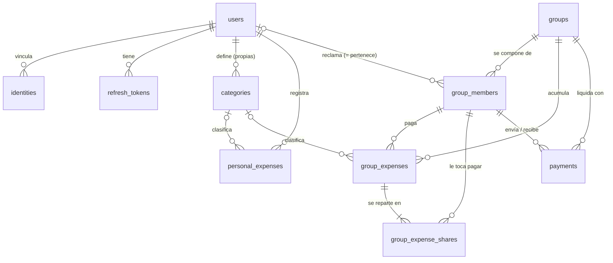

# WeSplit API — Features pendientes

Lista de features que debe tener la API y que se desarrollarán próximamente.
Añade cada feature al final de su sección con el formato indicado.

## Índice

- [Autenticación y usuarios](#autenticación-y-usuarios)
  - [✅ Login/registro con Google](#loginregistro-con-google)
  - [✅ Perfil propio](#perfil-propio)
  - [✅ Obtener usuario por ID](#obtener-usuario-por-id)
  - [✅ Refrescar access token](#refrescar-access-token)
  - [✅ Cerrar sesión en todos los dispositivos](#cerrar-sesión-en-todos-los-dispositivos)
  - [✅ Eliminar usuario](#eliminar-usuario)
  - [✅ Cerrar sesión en el dispositivo actual](#cerrar-sesión-en-el-dispositivo-actual)
  - [✅ Vincular y desvincular proveedores de login](#vincular-y-desvincular-proveedores-de-login)
- [Grupos](#grupos)
  - [✅ Crear grupo](#crear-grupo)
  - [✅ Listar grupos de un usuario](#listar-grupos-de-un-usuario)
  - [✅ Obtener un grupo](#obtener-un-grupo)
  - [✅ Editar grupo](#editar-grupo)
  - [✅ Eliminar grupo](#eliminar-grupo)
  - [✅ Listar miembros de un grupo](#listar-miembros-de-un-grupo)
  - [✅ Añadir miembros a un grupo](#añadir-miembros-a-un-grupo)
  - [✅ Editar miembro de un grupo](#editar-miembro-de-un-grupo)
  - [✅ Eliminar miembro de un grupo](#eliminar-miembro-de-un-grupo)
  - [✅ Obtener enlace de invitación del grupo](#obtener-enlace-de-invitación-del-grupo)
  - [✅ Ver un grupo desde el enlace de invitación](#ver-un-grupo-desde-el-enlace-de-invitación)
  - [✅ Unirse a un grupo mediante enlace](#unirse-a-un-grupo-mediante-enlace)
  - [✅ Cambiar de alias en el grupo](#cambiar-de-alias-en-el-grupo)
- [Gastos](#gastos)
  - Gastos individuales
    - [✅ Registrar gasto individual](#registrar-gasto-individual)
    - [✅ Listar gastos individuales](#listar-gastos-individuales)
    - [✅ Ver detalle de un gasto individual](#ver-detalle-de-un-gasto-individual)
    - [✅ Editar gasto individual](#editar-gasto-individual)
    - [✅ Eliminar gasto individual](#eliminar-gasto-individual)
  - Gastos de grupo
    - [✅ Registrar gasto de grupo](#registrar-gasto-de-grupo)
    - [✅ Listar gastos de grupo](#listar-gastos-de-grupo)
    - [✅ Ver detalle de un gasto de grupo](#ver-detalle-de-un-gasto-de-grupo)
    - [✅ Editar gasto de grupo](#editar-gasto-de-grupo)
    - [✅ Eliminar gasto de grupo](#eliminar-gasto-de-grupo)
- [Categorías](#categorías)
  - [✅ Listar categorías](#listar-categorías)
  - [✅ Crear categoría personalizada](#crear-categoría-personalizada)
  - [✅ Editar categoría personalizada](#editar-categoría-personalizada)
  - [✅ Eliminar categoría personalizada](#eliminar-categoría-personalizada)
- [Saldos y liquidaciones](#saldos-y-liquidaciones)
  - [✅ Listar saldos de un grupo](#listar-saldos-de-un-grupo)
  - [✅ Resumen de saldos del usuario](#resumen-de-saldos-del-usuario)
- [Pagos](#pagos)
  - [✅ Registrar pago entre miembros](#registrar-pago-entre-miembros)
  - [✅ Listar pagos de un grupo](#listar-pagos-de-un-grupo)
  - [✅ Eliminar un pago](#eliminar-un-pago)
- [Transversal](#transversal)
  - [⬜ Paginación y filtrado en listados](#paginación-y-filtrado-en-listados)
- [Modelo de datos](#modelo-de-datos)
  - [Diagrama](#diagrama)
  - [Tablas](#tablas)
  - [Decisiones de diseño](#decisiones-de-diseño)
  - [Normalización](#normalización)
  - [Cálculo de saldos](#cálculo-de-saldos)
  - [Qué queda fuera a propósito](#qué-queda-fuera-a-propósito)

## Formato

```markdown
### [Nombre corto de la feature]

- **Estado:** ⬜ pendiente | 🔄 en curso | ✅ hecha
- **Descripción:** qué debe hacer y para quién.
- **Endpoints (orientativo):** `METHOD /ruta`
- **Notas:** requisitos, reglas de negocio, dependencias.
```

## Autenticación y usuarios

### Login/registro con Google

- **Estado:** ✅ hecha
- **Descripción:** verifica el id_token de Google, crea el usuario si no existe o lo vincula si ya existe por email, y devuelve un accessToken (JWT) y un refreshToken.
- **Endpoints (orientativo):** `POST /auth/google`
- **Notas:** rechaza emails no verificados. Rate limit de autenticación.

### Perfil propio

- **Estado:** ✅ hecha
- **Descripción:** devuelve los datos del usuario autenticado.
- **Endpoints (orientativo):** `GET /auth/me`

### Obtener usuario por ID

- **Estado:** ✅ hecha
- **Descripción:** devuelve los datos públicos de un usuario por su id.
- **Endpoints (orientativo):** `GET /users/:id`
- **Notas:** cualquier usuario autenticado puede consultar cualquier id. Ver la feature de control de acceso pendiente.

### Refrescar access token

- **Estado:** ✅ hecha
- **Descripción:** intercambia un refreshToken válido por un nuevo par de tokens.
- **Endpoints (orientativo):** `POST /auth/refresh`
- **Notas:** rota el refresh token (el usado queda revocado) y es independiente del proveedor de login.

### Cerrar sesión en todos los dispositivos

- **Estado:** ✅ hecha
- **Descripción:** revoca todos los refresh tokens del usuario.
- **Endpoints (orientativo):** `POST /auth/logout`
- **Notas:** el accessToken en curso sigue válido hasta que expire.

### Eliminar usuario

- **Estado:** ✅ hecha
- **Descripción:** el usuario autenticado puede borrar su cuenta.
- **Endpoints (orientativo):** `DELETE /users/me`
- **Notas:** borrado **definitivo**. La BD lo resuelve entero por claves foráneas: identidades, refresh tokens, categorías propias y gastos individuales se borran en cascada; sus miembros de grupo quedan desvinculados (`user_id` a NULL, alias sin dueño) y sus gastos y pagos de grupo sobreviven sin autor. Ni los gastos ni los saldos de los demás miembros cambian.

### Cerrar sesión en el dispositivo actual

- **Estado:** ✅ hecha
- **Descripción:** revocar solo el refresh token del dispositivo desde el que se cierra sesión.
- **Endpoints (orientativo):** `POST /auth/logout`, con `refresh_token` opcional en el body.
- **Notas:** mismo endpoint que el cierre en todos los dispositivos, no uno nuevo. Sin body, revoca todos los refresh tokens (comportamiento histórico); con `refresh_token`, revoca solo ese. Compatible hacia atrás.

### Vincular y desvincular proveedores de login

- **Estado:** ✅ hecha
- **Descripción:** asociar a una cuenta otros proveedores de identidad además de Google, y quitarlos.
- **Endpoints (orientativo):** `POST /users/me/identities`, `DELETE /users/me/identities/:provider`
- **Notas:** la tabla `identities` ya estaba preparada para varios proveedores. Incluye también `GET /users/me/identities` para listar las vinculadas. Vincular es idempotente si el proveedor ya era de este mismo usuario, y se rechaza con 409 si ya pertenece a otro. Desvincular comprueba primero que el proveedor exista (404 si no) y solo después si es el último método de acceso de la cuenta (409 si lo es, para no dejarla sin forma de entrar).

## Grupos

### Modelo de miembros y alias

Un grupo se compone de **miembros**. Un miembro es un alias (un nombre) dentro del grupo y puede estar vinculado a un usuario registrado o no estarlo. Los gastos, los saldos y los pagos se asocian siempre al miembro, nunca directamente al usuario.

El alias es el nombre que se muestra siempre dentro del grupo, también después de vincularse: no se sustituye por el nombre del usuario. Así, quien reparte los gastos sigue viendo los mismos nombres que escribió al crear el grupo, se hayan vinculado sus dueños o no.

**Pertenecer al grupo es tener en él un alias reclamado.** No hay un concepto de acceso separado del de miembro: como un usuario sin alias no puede hacer nada dentro del grupo, no tiene sentido registrar ese estado. Quien recibe el enlace puede ver el grupo y sus alias para elegir el suyo, y al elegirlo entra y queda vinculado en un solo paso. Hasta entonces no es miembro y no puede consultar ni modificar nada.

De ahí sale la situación que da sentido al modelo: **un alias con gastos a su nombre que no tiene ningún usuario detrás**. Es lo normal mientras el grupo se va completando, y los saldos de ese alias son correctos desde el primer momento.

Los permisos se siguen de ahí: cualquier miembro puede consultar y modificar cualquier gasto del grupo, lo haya registrado él o no. El rol de administrador, que hace falta para editar o eliminar el grupo, vive en el propio miembro.

El flujo previsto es el de Tricount:

1. Quien crea el grupo añade a todos los participantes indicando solo su nombre, sin vincularlos a ningún usuario real.
2. Desde ese momento ya se pueden repartir gastos entre todos los miembros del grupo, aunque ninguno esté vinculado.
3. Cuando otro usuario abre el enlace, ve la lista de alias e indica cuál es el suyo (ver [Unirse a un grupo mediante enlace](#unirse-a-un-grupo-mediante-enlace)).
4. A partir de ese momento los gastos de ese alias se reflejan en su dashboard. Los gastos no se modifican: siguen apuntando al mismo miembro, que ahora tiene un usuario asociado.

### Crear grupo

- **Estado:** ✅ hecha
- **Descripción:** un usuario autenticado puede crear un grupo de gastos compartidos. Al crearlo se crea también su miembro, con su nombre, ya vinculado a su usuario y con rol de administrador, y puede añadir de una vez el resto de miembros indicando solo su nombre.
- **Endpoints (orientativo):** `POST /groups`
- **Notas:** el enlace de invitación del grupo se genera aquí y ya no cambia. El nombre es obligatorio; la descripción es opcional y editable. El creador es el único administrador al crear el grupo. Los miembros iniciales se envían en la misma petición (`aliases: string[]`), con el mismo efecto que llamar después a `POST /groups/:groupId/members`.

### Listar grupos de un usuario

- **Estado:** ✅ hecha
- **Descripción:** un usuario autenticado puede ver todos los grupos de los que es miembro.
- **Endpoints (orientativo):** `GET /groups`
- **Notas:** son los grupos en los que el usuario tiene un alias reclamado. Devuelve en cada uno su alias, su rol y el número de miembros del grupo, que es lo que el frontend necesita para marcar sus gastos. Paginación según la sección [Transversal](#transversal).

### Obtener un grupo

- **Estado:** ✅ hecha
- **Descripción:** un miembro puede consultar un grupo concreto y cuál es su alias en él. No estaba en el backlog original: se añadió porque, tras unirse por enlace, hacía falta una forma de leer ese grupo sin tener que listarlos todos.
- **Endpoints (orientativo):** `GET /groups/:groupId`
- **Notas:** 404 si el grupo no existe, 403 si existe pero el usuario no es miembro (los ids son UUID inadivinables, así que el 403 no revela nada útil).

### Editar grupo

- **Estado:** ✅ hecha
- **Descripción:** un administrador del grupo puede modificar sus datos.
- **Endpoints (orientativo):** `PATCH /groups/:groupId`
- **Notas:** solo administradores. Los campos editables son el nombre y la descripción; el enlace de invitación no se edita aquí, es permanente.

### Eliminar grupo

- **Estado:** ✅ hecha
- **Descripción:** un administrador del grupo puede eliminarlo.
- **Endpoints (orientativo):** `DELETE /groups/:groupId`
- **Notas:** solo administradores. El borrado es definitivo y se lleva por delante miembros, gastos, repartos y pagos del grupo. Técnicamente requiere diferir las comprobaciones de integridad hasta el `COMMIT` (`SET CONSTRAINTS ALL DEFERRED`), documentado en la sección [Modelo de datos](#modelo-de-datos).

### Listar miembros de un grupo

- **Estado:** ✅ hecha
- **Descripción:** devuelve los miembros del grupo con su alias y, si lo tienen, el usuario al que están vinculados. Es la lista que el frontend usa para elegir pagador y participantes de un gasto, y para que un usuario recién llegado elija cuál es su alias.
- **Endpoints (orientativo):** `GET /groups/:groupId/members`
- **Notas:** solo para miembros del grupo. Quien todavía no lo es y llega con el enlace usa [Ver un grupo desde el enlace de invitación](#ver-un-grupo-desde-el-enlace-de-invitación). El nombre que se devuelve es siempre el alias, no el del usuario vinculado. Basta con indicar de cada miembro si está vinculado, a qué usuario y con qué rol, sin exponer su email.

### Añadir miembros a un grupo

- **Estado:** ✅ hecha
- **Descripción:** añadir uno o varios miembros a un grupo existente indicando únicamente su nombre. No hace falta que esas personas estén registradas ni que se les invite: desde que existe el alias ya se le pueden imputar gastos.
- **Endpoints (orientativo):** `POST /groups/:groupId/members`
- **Notas:** el alias nace sin vincular a ningún usuario y con rol de miembro. Lo puede hacer cualquier miembro del grupo, no solo administradores. El nombre es único dentro del grupo (sin distinguir mayúsculas), así que al elegir alias no hay ambigüedad; dos alias iguales en la misma petición se rechazan con 400 y uno que ya existe en el grupo con 409. **No se permite crear un miembro ya vinculado a un usuario conocido**: el único camino para vincular un alias es el enlace de invitación.

### Editar miembro de un grupo

- **Estado:** ✅ hecha
- **Descripción:** renombrar el alias de un miembro, por ejemplo para corregir una errata antes de que su dueño lo reclame.
- **Endpoints (orientativo):** `PATCH /groups/:groupId/members/:memberId`
- **Notas:** renombrar no afecta a los gastos, que apuntan al id del miembro. Un alias sin reclamar lo puede renombrar cualquier miembro; uno ya reclamado, solo su dueño o un administrador.

### Eliminar miembro de un grupo

- **Estado:** ✅ hecha
- **Descripción:** quitar un miembro del grupo.
- **Endpoints (orientativo):** `DELETE /groups/:groupId/members/:memberId`
- **Notas:** solo un administrador puede eliminar miembros. Se bloquea con 409 si el miembro aparece en algún gasto o pago (hay que liquidar o reasignar antes) o si es el último administrador del grupo. Eliminar un miembro vinculado no borra el usuario, solo su participación en ese grupo. Abandonar el grupo por uno mismo queda fuera de alcance.

### Obtener enlace de invitación del grupo

- **Estado:** ✅ hecha
- **Descripción:** obtener el enlace de invitación del grupo para compartirlo.
- **Endpoints (orientativo):** `GET /groups/:groupId/invitation`
- **Notas:** cada grupo tiene **un único enlace, creado junto con el grupo y permanente**: no se regenera ni se revoca, así que un enlace compartido en su día sigue funcionando siempre. El token es un aleatorio criptográfico de 32 bytes. Puede obtenerlo cualquier miembro del grupo, no solo administradores.

### Ver un grupo desde el enlace de invitación

- **Estado:** ✅ hecha
- **Descripción:** devuelve los datos básicos del grupo y la lista de sus alias a quien llega con el enlace, para que pueda elegir cuál es el suyo antes de entrar.
- **Endpoints (orientativo):** `GET /invitations/:token`
- **Notas:** lo que autoriza aquí es tener el token, no ser miembro. Por eso devuelve lo mínimo: nombre del grupo, alias y cuáles están ya cogidos. Ningún importe, ningún saldo y ningún email. Responder 404 si el token no corresponde a ningún grupo.

### Unirse a un grupo mediante enlace

- **Estado:** ✅ hecha
- **Descripción:** un usuario autenticado llega con el enlace, indica cuál de los alias es el suyo y con eso entra en el grupo. Unirse y reclamar alias son la misma operación. A partir de ese momento ese miembro queda vinculado a su usuario y todos los gastos, saldos y pagos que ya estaban a nombre de ese alias pasan a reflejarse en su dashboard.
- **Endpoints (orientativo):** `POST /invitations/:token/join`, con el alias elegido en el body.
- **Notas:** no se modifica ningún gasto. Los gastos apuntan al id del miembro, así que basta con escribir el usuario en el miembro para que todo lo anterior quede vinculado de forma retroactiva.
  - El enlace no caduca ni tiene límite de usos. Responder 404 si el token no corresponde a ningún grupo.
  - Un alias ya reclamado por otro usuario no se puede coger: la petición se rechaza con un conflicto. Así nadie puede apropiarse de los gastos de otro.
  - Un usuario puede tener como mucho un alias por grupo. Si ya es miembro y vuelve a entrar por el enlace, no se duplica nada; cambiar de alias es la feature siguiente.
  - El alias conserva su nombre al reclamarlo. Se sigue mostrando ese nombre en gastos, saldos y listados, no el del usuario que lo cogió.
  - El miembro entra con el rol que ya tuviera ese alias (siempre `member`, porque los alias nacen así). Crear un alias al vuelo si ninguno corresponde al usuario queda fuera de alcance.

### Cambiar de alias en el grupo

- **Estado:** ✅ hecha
- **Descripción:** un miembro del grupo se pasa a otro alias, para corregirse si se equivocó al elegir.
- **Endpoints (orientativo):** `POST /groups/:groupId/members/:memberId/claim`
- **Notas:** el alias que tenía vuelve a quedar libre, con sus gastos intactos, y el nuevo queda vinculado a su usuario. El rol se arrastra al nuevo alias, para no dejar el grupo sin administrador por un simple cambio de alias. Solo se puede pasar a un alias sin dueño; si ya tiene otro, se rechaza con un conflicto. Soltar el alias sin coger otro (abandonar el grupo) queda fuera de alcance.

## Gastos

### Registrar gasto individual

- **Estado:** ✅ hecha
- **Descripción:** un usuario autenticado puede registrar un gasto sin asociarlo a ningún grupo.
- **Endpoints (orientativo):** `POST /expenses`
- **Notas:** campos: descripción, importe, fecha y categoría opcional (predefinida o propia del usuario, a diferencia de los gastos de grupo). Convertir un gasto individual en uno de grupo queda fuera de alcance. Los importes, aquí y en todo el proyecto, son siempre en euros.

### Listar gastos individuales

- **Estado:** ✅ hecha
- **Descripción:** un usuario autenticado puede ver sus gastos individuales.
- **Endpoints (orientativo):** `GET /expenses`
- **Notas:** solo devuelve gastos del propio usuario. Filtros por fecha y categoría, con paginación según la sección [Transversal](#transversal).

### Ver detalle de un gasto individual

- **Estado:** ✅ hecha
- **Descripción:** devuelve los datos de un gasto individual concreto.
- **Endpoints (orientativo):** `GET /expenses/:expenseId`
- **Notas:** solo el propietario puede verlo. Responder 404 si no existe o pertenece a otro usuario, para no revelar su existencia.

### Editar gasto individual

- **Estado:** ✅ hecha
- **Descripción:** el propietario puede modificar los datos de un gasto individual.
- **Endpoints (orientativo):** `PATCH /expenses/:expenseId`
- **Notas:** todos los campos son editables (descripción, importe, fecha, categoría). No se guarda historial de cambios.

### Eliminar gasto individual

- **Estado:** ✅ hecha
- **Descripción:** el propietario puede eliminar un gasto individual.
- **Endpoints (orientativo):** `DELETE /expenses/:expenseId`
- **Notas:** el borrado es lógico (`deleted_at`), igual que en los gastos de grupo.

### Registrar gasto de grupo

- **Estado:** ✅ hecha
- **Descripción:** cualquier miembro del grupo puede registrar un gasto en él, aunque no sea quien lo pagó. Debe poder indicar qué miembro pagó y entre qué miembros se reparte.
- **Endpoints (orientativo):** `POST /groups/:groupId/expenses`
- **Notas:** el pagador y los participantes se identifican por el id del miembro, no por el del usuario, y pueden ser alias sin vincular (ver [Modelo de miembros y alias](#modelo-de-miembros-y-alias)). Quien registra el gasto tiene que ser miembro, es decir, tener su alias reclamado. El importe se guarda siempre como cantidad exacta por cada participante: el cálculo de las partes (iguales, porcentajes, etc.) lo hace el frontend y la API solo recibe el resultado. Validado en el servicio (no es una restricción de la base de datos): todos los miembros indicados deben pertenecer al grupo (422 si no) y la suma de los importes de los participantes debe coincidir con el total del gasto (422 si no, con ambos importes en el detalle del error). La categoría es opcional y **solo puede ser una categoría predefinida**, nunca una personalizada de quien registra el gasto (ver sección [Categorías](#categorías)): así ninguna categoría privada se filtra al resto del grupo.

### Listar gastos de grupo

- **Estado:** ✅ hecha
- **Descripción:** cualquier miembro del grupo puede ver los gastos de ese grupo.
- **Endpoints (orientativo):** `GET /groups/:groupId/expenses`
- **Notas:** solo para miembros. Filtros por fecha, categoría y pagador (por id de miembro), con paginación según la sección [Transversal](#transversal).

### Ver detalle de un gasto de grupo

- **Estado:** ✅ hecha
- **Descripción:** devuelve los datos de un gasto de grupo concreto, con qué miembro pagó y cómo se reparte entre los miembros.
- **Endpoints (orientativo):** `GET /groups/:groupId/expenses/:expenseId`
- **Notas:** solo para miembros del grupo. Responder 404 si el gasto no pertenece a ese grupo.

### Editar gasto de grupo

- **Estado:** ✅ hecha
- **Descripción:** modificar un gasto de grupo ya registrado (importe, descripción, pagador, reparto).
- **Endpoints (orientativo):** `PATCH /groups/:groupId/expenses/:expenseId`
- **Notas:** puede editarlo cualquier miembro del grupo, lo haya registrado él o no y sea o no el pagador. No hace falta ser administrador. Si se cambia el importe o el reparto, la suma tiene que seguir cuadrando; si uno de los dos cambia y el otro no, y dejan de cuadrar, se rechaza con 422 (no se reescala el reparto por nuestra cuenta). No se guarda historial de cambios.

### Eliminar gasto de grupo

- **Estado:** ✅ hecha
- **Descripción:** eliminar un gasto de grupo.
- **Endpoints (orientativo):** `DELETE /groups/:groupId/expenses/:expenseId`
- **Notas:** mismo criterio que editar: cualquier miembro del grupo. El borrado es lógico (`deleted_at`): el gasto deja de listarse y de contar en los saldos, pero no se pierde.

## Categorías

Las categorías clasifican los gastos. Hay dos tipos: predefinidas, registradas en BD y comunes a todos los usuarios, y personalizadas, que define cada usuario y solo son visibles para él.

### Listar categorías

- **Estado:** ✅ hecha
- **Descripción:** devuelve las categorías predefinidas y las personalizadas del usuario autenticado, para elegirlas al registrar un gasto.
- **Endpoints (orientativo):** `GET /categories`
- **Notas:** las predefinidas no se pueden modificar ni eliminar y aparecen primero en el listado, seguidas de las personalizadas por orden alfabético. Se cargan mediante migración (`seed-predefined-categories`), no con un seed aparte. Paginación según la sección [Transversal](#transversal).

### Crear categoría personalizada

- **Estado:** ✅ hecha
- **Descripción:** el usuario crea una categoría propia para clasificar sus gastos.
- **Endpoints (orientativo):** `POST /categories`
- **Notas:** visible solo para su creador. El nombre es único por usuario (sin distinguir mayúsculas) y puede coincidir con el de una predefinida. Una categoría es su nombre y, opcionalmente, un color: no lleva icono.

### Editar categoría personalizada

- **Estado:** ✅ hecha
- **Descripción:** el propietario puede renombrar o modificar una categoría personalizada.
- **Endpoints (orientativo):** `PATCH /categories/:categoryId`
- **Notas:** solo el propietario. Si los gastos referencian la categoría por id, el cambio se refleja en ellos sin tocarlos. Tocar una predefinida o una ajena responde 404, para no revelar las categorías privadas de otro usuario.

### Eliminar categoría personalizada

- **Estado:** ✅ hecha
- **Descripción:** el propietario puede eliminar una categoría personalizada.
- **Endpoints (orientativo):** `DELETE /categories/:categoryId`
- **Notas:** solo el propietario (404 en cualquier otro caso, igual que al editar). Los gastos que la usaban se quedan sin categoría: lo resuelve por sí solo el `ON DELETE SET NULL` del esquema, sin lógica adicional.

## Saldos y liquidaciones

### Listar saldos de un grupo

- **Estado:** ✅ hecha
- **Descripción:** cualquier miembro del grupo puede ver el saldo de cada miembro: cuánto le deben o cuánto debe.
- **Endpoints (orientativo):** `GET /groups/:groupId/balances`
- **Notas:** solo para miembros, igual que los gastos de los que salen estos saldos. Depende de los gastos de grupo y de sus importes exactos por participante. Devuelve el saldo neto de cada miembro y las transferencias simplificadas calculadas en el momento de la consulta. Los saldos se calculan por miembro y se devuelven todos, estén vinculados a un usuario o no: un grupo cuyos miembros son solo alias tiene saldos completos y correctos.

### Resumen de saldos del usuario

- **Estado:** ✅ hecha
- **Descripción:** el dashboard del usuario autenticado: cuánto debe y cuánto le deben en total, sumando todos sus grupos.
- **Endpoints (orientativo):** `GET /me/balances`
- **Notas:** suma el saldo de los miembros vinculados a su usuario, un miembro por grupo como mucho. Al coger un alias, los gastos previos de ese alias aparecen aquí sin ninguna migración de datos. Devuelve tres cifras, no una: lo que le deben, lo que debe y el neto. **No se netean los grupos entre sí**: deber 50 en un grupo y que le deban 50 en otro no es "no deber nada", porque no se puede pagar una deuda con el crédito de un grupo distinto.

## Pagos

### Registrar pago entre miembros

- **Estado:** ✅ hecha
- **Descripción:** registrar un pago de dinero de un miembro a otro del mismo grupo para saldar, total o parcialmente, lo que le debe. El pago ajusta los saldos del grupo.
- **Endpoints (orientativo):** `POST /groups/:groupId/payments`
- **Notas:** emisor y receptor se identifican por id de miembro y pueden ser alias sin vincular, igual que en los gastos: dos personas sin cuenta pueden saldarse entre ellas y que quede registrado. Lo puede registrar **cualquier miembro del grupo**, no solo las dos partes, mismo criterio que los gastos: si quien paga es un alias sin usuario detrás, alguien tiene que poder registrarlo por él. El receptor no confirma nada. Los pagos no son editables, solo eliminables (ver features siguientes).

### Listar pagos de un grupo

- **Estado:** ✅ hecha
- **Descripción:** cualquier miembro del grupo puede ver los pagos registrados en él. No estaba en el backlog original: se añadió junto con el borrado, para poder revisar un pago antes de eliminarlo.
- **Endpoints (orientativo):** `GET /groups/:groupId/payments`
- **Notas:** solo para miembros. Paginación según la sección [Transversal](#transversal). Sin filtros propios por ahora.

### Eliminar un pago

- **Estado:** ✅ hecha
- **Descripción:** cualquier miembro del grupo puede eliminar un pago mal registrado. No estaba en el backlog original: sin él, un pago equivocado era irreparable y la columna `payments.deleted_at` del esquema habría quedado sin uso.
- **Endpoints (orientativo):** `DELETE /groups/:groupId/payments/:paymentId`
- **Notas:** borrado lógico, igual que los gastos: deja de contar en los saldos pero no se pierde.

## Transversal

### Paginación y filtrado en listados

- **Estado:** 🔄 en curso
- **Descripción:** los endpoints que devuelven colecciones son paginados y permiten filtrar sus resultados.
- **Endpoints (orientativo):** `GET /groups`, `GET /expenses`, `GET /groups/:groupId/expenses`, `GET /groups/:groupId/members`, `GET /categories`, y cualquier otro listado que se añada.
- **Notas:** convención cerrada e implementada en `GET /groups` y `GET /groups/:groupId/members`: querystring `?page=1&limit=20` (página en base 1, límite máximo 100, por defecto 20), respuesta envuelta en `{ data: [...], pagination: { page, limit, total, total_pages } }`. Falta aplicarla al resto de listados a medida que se implementan. Los filtros concretos (fecha, pagador, categoría, etc.) se definen en la feature de cada listado.

## Modelo de datos

El esquema completo en SQL está en [`schema.sql`](schema.sql), que es un documento de referencia: la base de datos viva se construye con las migraciones de `migrations/`. Esta sección resume qué hay y, sobre todo, por qué.

El esquema se ha probado contra un PostgreSQL 16 real: aplica limpio y cumple las invariantes de la sección [Decisiones de diseño](#decisiones-de-diseño).

### Diagrama



### Tablas

| Tabla                  | Qué guarda                                                                                          | Clave                                      |
| ---------------------- | --------------------------------------------------------------------------------------------------- | ------------------------------------------ |
| `users`                | Cuentas registradas. Ya existe.                                                                     | `id`                                       |
| `identities`           | Proveedores de login vinculados a una cuenta. Ya existe.                                            | `id`, único `(provider, provider_user_id)` |
| `refresh_tokens`       | Refresh tokens opacos, revocables. Ya existe.                                                       | `id`, único `token_hash`                   |
| `categories`           | Categorías de gasto. `user_id` NULL = predefinida.                                                  | `id`                                       |
| `groups`               | El grupo y su enlace de invitación permanente.                                                      | `id`, único `invitation_token`             |
| `group_members`        | Los alias del grupo y, a la vez, quién pertenece a él y con qué rol. `user_id` NULL = sin reclamar. | `id`, único `(group_id, user_id)`          |
| `personal_expenses`    | Gastos individuales, sin grupo ni reparto.                                                          | `id`                                       |
| `group_expenses`       | Gasto del grupo: total, pagador y categoría.                                                        | `id`                                       |
| `group_expense_shares` | Cuánto le toca a cada participante de ese gasto.                                                    | `(group_expense_id, member_id)`            |
| `payments`             | Dinero que un miembro entrega a otro para saldar.                                                   | `id`                                       |

### Decisiones de diseño

**1. Una sola tabla para alias y pertenencia.** `group_members` responde a la vez a "entre quiénes se reparte el dinero" y a "quién es del grupo": un usuario pertenece al grupo si tiene aquí un alias reclamado.

Hubo una tabla `group_access` aparte, para registrar a quien había entrado por el enlace pero todavía no había elegido alias. Se quitó al ver que ese estado no da derecho a nada: con las reglas de permisos del proyecto, sin alias no se puede ni consultar un gasto. Lo único que quedaba era durar los segundos que se tarda en pulsar un nombre, a cambio de dos tablas que sincronizar y de una invariante que la base de datos no podía garantizar, porque nada impedía un alias reclamado por un usuario sin fila de acceso.

Ahora quien tiene el enlace consulta el grupo con el token (`GET /invitations/:token`) y entra eligiendo alias en un solo paso. Lo que se pierde es que el grupo aparezca en la lista del usuario antes de elegir; como el enlace es permanente, volver a abrirlo siempre funciona.

**2. Todo el dinero apunta al miembro, nunca al usuario.** `group_expenses.paid_by_member_id`, `group_expense_shares.member_id` y las dos puntas de `payments` referencian `group_members`. Esta es la decisión que hace funcionar el modelo de alias: reclamar un alias es un `UPDATE` de una sola columna y los gastos anteriores quedan vinculados sin tocar ni una fila más.

**3. El rol vive en el miembro.** `group_members.role` vale `admin` o `member` y solo significa algo cuando el alias está reclamado. En uno libre se queda en `member` y no estorba, aunque deja la puerta abierta a preparar un alias como administrador antes de que su dueño lo coja.

**4. Reclamar un alias se hace con un `UPDATE` condicional.** El índice único `(group_id, user_id)` garantiza que un usuario no tenga dos alias en un grupo, pero no impide quedarse con el alias de otro. Eso se consigue con `UPDATE ... WHERE id = $miembro AND user_id IS NULL`: si afecta a 0 filas, el alias ya tenía dueño y se responde conflicto. Es atómico y no necesita bloqueos.

**5. Gastos individuales y de grupo en tablas separadas.** Tienen reglas de borrado opuestas: el gasto individual de una cuenta borrada se va con ella (`ON DELETE CASCADE`), mientras que el de grupo tiene que sobrevivir porque afecta a saldos de terceros (`created_by_user_id` a NULL). Una sola tabla no puede tener dos comportamientos en la misma columna, y forzarlo significaría sacar la integridad de la base de datos. Convertir un gasto individual en uno de grupo, si se implementa, es un `INSERT` + `DELETE` en una transacción.

**6. El reparto va en una tabla hija, con importes exactos.** Una fila por participante en `group_expense_shares`, con la clave primaria `(group_expense_id, member_id)` para que nadie aparezca dos veces en el mismo gasto. Nada de columnas tipo `participante_1`, ni porcentajes: el frontend calcula las partes y la API guarda cantidades.

**7. No se guarda la moneda en ninguna parte.** La aplicación es monomoneda: todos los importes son euros. Guardar un `currency` que siempre vale lo mismo no aporta nada y da falsa sensación de soportar divisas. Si algún día hiciera falta multidivisa de verdad, lo que hay que añadir no es una columna de moneda suelta, sino el tipo de cambio y el importe convertido, porque sin eso no se pueden sumar saldos.

**8. Integridad entre grupos con clave foránea compuesta.** `group_members` tiene un `UNIQUE (id, group_id)` aparentemente redundante que permite a `group_expenses` y `payments` apuntar a `(miembro, grupo)` en vez de solo al miembro. Así la base de datos rechaza por sí sola un gasto cuyo pagador pertenece a otro grupo, sin depender de que el servicio lo valide.

**9. Esas claves foráneas son `DEFERRABLE INITIALLY IMMEDIATE`.** En el día a día se comprueban al instante, con errores claros. Pero al borrar un grupo la cascada vacía miembros y gastos en la misma sentencia y sin orden garantizado, lo que haría fallar la comprobación inmediata. Por eso el borrado de un grupo, y solo ese, abre la transacción con `SET CONSTRAINTS ALL DEFERRED`. Esto se probó: sin diferir, el borrado falla; difiriendo, funciona.

**10. Borrado lógico solo donde afecta a saldos.** `deleted_at` está en `personal_expenses`, `group_expenses` y `payments`, que son los registros que otros miembros ya han visto reflejados en sus cuentas. Grupos, miembros y categorías se borran de verdad. Si se decide que el borrado de gastos sea definitivo, la columna sobra y se quita.

**11. Borrar un miembro con gastos está bloqueado por la base de datos.** No hay `ON DELETE CASCADE` desde `group_members` hacia gastos ni pagos: borrar un alias que aparece en algún gasto falla. Primero hay que liquidar o reasignar.

**12. `updated_at` lo mantiene un trigger**, no la aplicación, para que no dependa de que cada repositorio se acuerde.

**13. No se guarda la fecha de reclamación del alias.** Se probó con una columna `claimed_at` y una restricción que la mantuviera coherente con `user_id`, y se quitó: `ON DELETE SET NULL` solo puede anular `user_id`, así que al borrar una cuenta quedaba una fecha de reclamación apuntando a un alias ya libre, y la restricción hacía fallar el borrado. Si hiciera falta auditar reclamaciones, su sitio es una tabla de histórico aparte.

**14. El enlace de invitación es una columna de `groups`, no una tabla.** El grupo tiene un único enlace, creado con él y permanente: no se regenera ni se revoca. Sin ciclo de vida que modelar no hay nada que justifique una tabla aparte, así que `groups.invitation_token` con un índice único basta. El token se guarda en claro, a diferencia de los refresh tokens, porque hay que poder volver a mostrarlo cada vez que alguien pide el enlace: es un secreto del tipo "quien tiene el enlace entra", como un documento compartido por URL. Si en el futuro hiciera falta revocarlo, caducarlo o llevar varios a la vez, entonces sí tocaría sacarlo a su propia tabla.

### Normalización

- **1FN:** nada de listas dentro de una columna. El reparto de un gasto son filas de `group_expense_shares`, una por participante.
- **2FN:** la única clave primaria compuesta es la de `group_expense_shares`, y su `amount` depende de las dos partes. Por eso **no** se duplica ahí el `group_id`: dependería solo de `group_expense_id`, que es parte de la clave, y sería una dependencia parcial.
- **3FN y BCNF:** se cumplen con **una excepción deliberada**. En `group_expenses` y `payments`, el `group_id` se puede deducir del miembro al que apuntan, así que es una dependencia transitiva. Se mantiene porque es el camino de consulta principal (todos los listados filtran por grupo) y porque la clave foránea compuesta de la decisión 8 hace imposible que las dos columnas se contradigan. Una dependencia redundante que el motor garantiza no puede producir anomalías de actualización, que es de lo que protege la tercera forma normal.
- `categories` mezcla predefinidas y personalizadas en una tabla con `user_id` nullable. No rompe ninguna forma normal y evita duplicar la estructura y las claves foráneas de los gastos en dos tablas casi idénticas.

### Cálculo de saldos

Positivo significa que el grupo le debe al miembro; negativo, que el miembro debe. La suma de todos los saldos de un grupo es siempre cero.

```
saldo = lo que ha pagado
      - lo que le tocaba pagar
      + lo que ha entregado en pagos
      - lo que ha recibido en pagos
```

La consulta completa está al final de [`schema.sql`](schema.sql). Comprobada con el caso de ejemplo: gasto de 90 pagado por Antonio y repartido 30/30/30 entre Antonio, Bea y Carlos, más un pago de 30 de Bea a Antonio, da Antonio +30, Bea 0 y Carlos −30, siendo Carlos un alias sin reclamar.

La simplificación de deudas se calcula en memoria a partir de estos saldos y no se guarda.

### Qué queda fuera a propósito

No se modelan todavía, y cada una entraría sin tocar lo existente: adjuntos y comentarios en los gastos, historial de cambios, gastos recurrentes, multidivisa con conversión, notificaciones, y caducar, revocar o llevar varios enlaces de invitación por grupo.

Tampoco hay restricción en la base de datos que obligue a que la suma del reparto cuadre con el total del gasto: es una regla entre filas, se valida en el servicio dentro de la misma transacción que escribe el gasto. Podría añadirse como trigger diferido si se quisiera garantizar desde el motor.
